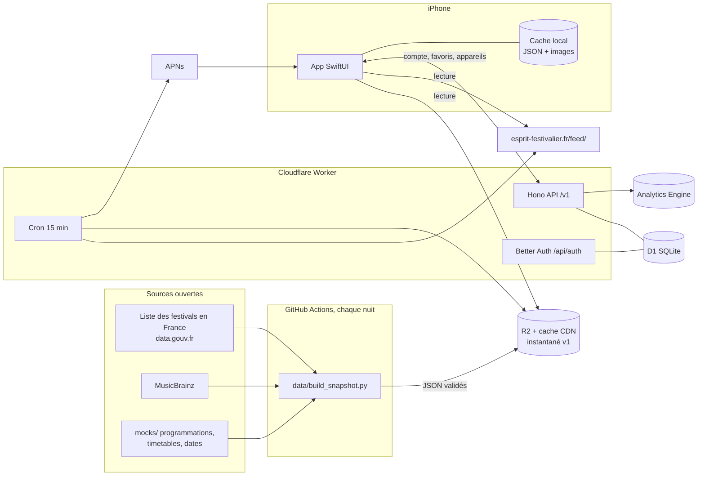

# Architecture : Esprit Festivalier App

**Date :** 2026-11-25
**Architecte :** clement
**Version :** 1.1 (ADR-007 : application complète, 2026-11-25)
**Type de projet :** mobile-app
**Niveau de projet :** 3
**Statut :** Validé (ADR-003 : option A, 2026-11-25)

---

## Présentation

Ce document décrit comment construire l'app pour satisfaire le PRD. Il couvre chaque exigence fonctionnelle (FR) et non fonctionnelle (NFR).

**Documents liés :**
- PRD : `docs/prd-esprit-festivalier-app-2026-11-25.md`
- Product brief : `docs/product-brief-esprit-festivalier-app-2026-11-25.md`
- Direction artistique : `docs/design/direction-artistique.md`

---

## Résumé

- **App iOS native** en SwiftUI (iOS 17 minimum), avec une logique et des sources de données dans un package Swift testable sans simulateur.
- **Données publiques** (festivals, programmations, timetables, artistes) : un **instantané JSON statique** produit chaque nuit par un script à partir des données ouvertes et des mocks, servi par Cloudflare (R2 et cache). Pas de serveur à faire tourner pour lire le catalogue.
- **Articles :** liste lue dans le flux RSS du site ; texte complet, auteurs et pages liste lus dans les pages du site et affichés en natif (ADR-007).
- **Application complète :** aucune fonction ne renvoie simplement vers le site ; seuls billetterie, itinéraire, partage, réglages et contenus tiers sortent de l'app (ADR-007).
- **Données personnelles** (compte, favoris, timetable, appareils, notifications) : une **API légère sur Cloudflare Workers** (TypeScript, Hono, Better Auth, base D1), avec des tâches planifiées pour les notifications.
- **Sources interchangeables :** l'app ne connaît que des interfaces (`FestivalSource`, `ArticleSource`…). Mocks, instantané ouvert et futur back-office sont des implémentations choisies par configuration.
- **Local d'abord :** favoris, timetable et fiches favorites vivent sur l'appareil et marchent hors ligne ; le compte ne sert qu'à synchroniser.

---

## Facteurs déterminants

1. **NFR-008, sources interchangeables** → interfaces par type de donnée, modèle interne unique, sélection de la source par configuration.
2. **NFR-003 et NFR-002, hors ligne et réseau faible** → stockage local d'abord, cache disque des fiches favorites et de leurs images, notifications locales pour les rappels.
3. **NFR-012, coût < 20 €/mois** → données publiques en fichiers statiques sur CDN ; API serverless dans les offres gratuites ou à 5 $/mois.
4. **NFR-005, RGPD** → la position ne quitte jamais l'appareil ; mesure d'audience anonyme et agrégée ; un consentement par usage.
5. **NFR-004, dépôt public** → aucun secret dans le code ; droits premium vérifiés côté serveur ; contenus premium jamais dans l'instantané public.
6. **NFR-010, Android plus tard** → contrats (JSON Schema, OpenAPI) écrits hors de Swift et partagés.

---

## Vue d'ensemble

### Architecture générale

Quatre blocs :

1. **App iOS** : écrans SwiftUI, modèles de vue, package `EFKit` (domaine, sources, cache, design system).
2. **Pipeline de données** (`data/`) : script Python lancé chaque nuit par GitHub Actions. Il lit les données ouvertes et les mocks, résout les artistes sur MusicBrainz, valide le résultat contre les schémas, puis publie les JSON sur R2.
3. **API** (`api/`) : Cloudflare Worker. Authentification, synchronisation des données personnelles, enregistrement des appareils, notifications push, mesure d'audience ; puis premium et concours en phase 2.
4. **Contrats** (`contracts/`) : JSON Schema de l'instantané et OpenAPI de l'API, sources de vérité pour iOS, Android et le futur back-office.

### Schéma



### Modèle d'architecture

**Modèle :** app native local d'abord + données publiques statiques + API serverless monolithique (un seul Worker, modules par domaine).

**Justification :** les données publiques changent peu (quelques fois par jour) et sont lues par tous : des fichiers statiques sur CDN sont plus rapides, moins chers et plus fiables qu'une API. Les données personnelles sont petites : un seul Worker suffit largement. Pas de microservices pour un projet bénévole.

---

## Choix techniques

### App iOS

**Choix :** Swift 6, SwiftUI, iOS 17 minimum, `@Observable`, `async/await`, Swift Testing.

**Justification :** iOS 17 donne Observation et les API SwiftUI récentes ; il couvre l'essentiel des iPhone en circulation. Swift 6 vérifie la concurrence à la compilation.

**Compromis :** les iPhone bloqués en iOS 16 sont exclus. La carte avec regroupement de points passe par `MKMapView` (SwiftUI `Map` ne regroupe pas les points en iOS 17).

### API

**Choix :** Cloudflare Workers en **TypeScript**, avec **Hono** (routes), **Better Auth** (authentification), **D1** (base), **Zod** (validation).

**Justification :** voir ADR-003. Better Auth est une bibliothèque TypeScript : il tourne nativement dans un Worker, avec D1. Une seule base de code, un seul déploiement.

**Compromis :** pas de FastAPI. Python reste utilisé pour le pipeline de données.

### Base de données

**Choix :** **D1** (SQLite managé) pour les comptes et les données personnelles ; **R2** pour l'instantané public et, plus tard, les photos ; **Workers Analytics Engine** pour la mesure d'audience.

**Justification :** volumes faibles (moins de 100 000 comptes visés), requêtes simples, offre gratuite large, aucune administration.

**Compromis :** limite de 10 Go par base D1 ; une seule région d'écriture. Largement suffisant ici.

### Infrastructure

**Choix :** Cloudflare (Workers, D1, R2, Cron Triggers), offre Workers Paid à 5 $/mois si les limites gratuites sont atteintes.

**Justification :** stack demandée, coût prévisible, pas de serveur.

### Services tiers

| Service | Usage | Phase |
|---|---|---|
| Liste des festivals en France (data.gouv.fr, Licence Ouverte 2.0) | Annuaire de base | 1 |
| MusicBrainz | Identifiants des artistes (dans le pipeline, pas dans l'app) | 1 |
| Flux RSS du site | Liste des articles | 1 |
| Pages du site (articles, auteurs, listes) | Texte complet, auteurs (ADR-007) | 1 |
| Apple MapKit | Carte, itinéraire | 1 |
| APNs | Notifications push | 1 |
| Sign in with Apple | Connexion | 1 |
| Resend (ou Cloudflare Email) | Codes de connexion par e-mail | 1 |
| WeatherKit | Météo des festivals | 2 |
| StoreKit 2 + App Store Server API | Premium | 2 |
| Apple MusicKit | Import des artistes | 2 |

### Développement et déploiement

- Git et GitHub, une PR par changement.
- GitHub Actions : build et tests iOS (runner macOS), tests de l'API (Vitest avec le pool Workers), tests du pipeline (pytest), construction nocturne de l'instantané.
- TestFlight : compte Apple Developer personnel de Clément Guyon ; envoi avec `xcodebuild` et le CLI `asc`.
- Déploiement de l'API : `wrangler deploy` depuis la CI après fusion sur `main`.

---

## Composants

### Composant : App iOS (cible `EspritFestivalier`)

**Rôle :** écrans et navigation.

**Responsabilités :**
- Onglets : Accueil, Festivals (liste et carte), Mes festivals, Articles, Profil.
- Un modèle de vue `@Observable` par écran ; aucune logique métier dans les vues.
- Injection des dépendances par un `AppEnvironment` placé dans l'environnement SwiftUI.

**Interfaces :** SwiftUI, adresses du site `/festival/<slug>/` et `/<slug>-<numéro>/` (article), routées dans l'app ; liens universels plus tard (FR-034) ; notifications.

**Dépendances :** `EFKit`.

**FR couvertes :** toutes les FR visibles.

### Composant : `EFKit` (package Swift local)

**Rôle :** tout ce qui se teste sans écran.

**Cibles :**
- `EFDomain` : modèles (`Festival`, `Performance`, `Artist`, `Article`…), règles (filtres, conflits de timetable, distance), interfaces des sources.
- `EFData` : implémentations des sources, cache disque, client de l'API, synchronisation.
- `EFDesign` : tokens de la DA (couleurs clair et sombre, polices, rayons, ombres), composants de base (carte, pastille, bouton).

**FR couvertes :** FR-001 à FR-012 (logique), NFR-007, NFR-008.

### Composant : couche de sources (cœur de NFR-008)

**Rôle :** séparer les écrans de l'origine des données.

**Interfaces (dans `EFDomain`) :**

```swift
public protocol FestivalSource: Sendable {
    func festivals(updatedSince: Date?) async throws -> [Festival]
    func festival(id: Festival.ID) async throws -> FestivalDetail
}

public protocol LineupSource: Sendable {
    func lineups() async throws -> [Lineup]
}

public protocol ArticleSource: Sendable {
    func articles(category: Article.Category?) async throws -> [Article]
}

public protocol ArtistSource: Sendable {
    func artists(ids: [Artist.ID]) async throws -> [Artist]
}
```

**Implémentations (dans `EFData`) :**

| Source | Festivals | Programmations | Articles | Artistes | Usage |
|---|---|---|---|---|---|
| `Mock…Source` | JSON embarqué | JSON embarqué | JSON embarqué | JSON embarqué | Tests, aperçus SwiftUI, démo sans réseau |
| `Snapshot…Source` | Instantané R2 | Instantané R2 | — | Instantané R2 | Bêta TestFlight |
| `RSSArticleSource` | — | — | Flux du site | — | Bêta TestFlight |
| `BackOffice…Source` | API du back-office | idem | idem | idem | Plus tard |

**Règles :**
- Chaque source convertit ses données vers le modèle interne ; aucun type d'une source ne sort de `EFData`.
- Un `CachedFestivalSource` enveloppe n'importe quelle source : il rend le cache tout de suite, puis met à jour (NFR-002).
- Le choix se fait dans `AppEnvironment` selon la configuration de build (`EF_DATA_SOURCE = mock | snapshot | backoffice`) ; un argument de lancement le force pour les tests.

**FR couvertes :** FR-001, FR-004, FR-006, FR-011 ; NFR-008.

### Composant : stockage local et synchronisation

**Rôle :** données de l'utilisateur sur l'appareil, synchronisées quand il est connecté.

**Responsabilités :**
- Favoris, concerts cochés, artistes suivis, préférences : fichiers JSON (`Codable`) dans Application Support.
- Synchronisation par lot avec l'API : chaque élément porte `updatedAt` et `deleted` ; le plus récent gagne.
- Fiches favorites et leurs images copiées dans Application Support (pas dans Caches, que le système peut vider).

**FR couvertes :** FR-008, FR-009, FR-016 ; NFR-003.

### Composant : notifications

**Rôle :** rappels locaux et notifications push.

**Responsabilités :**
- Rappels de timetable en **notifications locales**. Limite iOS : 64 notifications locales en attente. On programme donc les 64 plus proches, et on complète à chaque ouverture de l'app.
- Push : le Worker envoie à APNs (nouvel article par rubrique, programmation publiée, changement d'horaire d'un favori, J-7 et J-1, messages jour J).
- « Festival autour de moi » (FR-017) : calcul **sur l'appareil**. L'app utilise la surveillance des changements importants de position et l'instantané déjà téléchargé, puis envoie une notification locale. La position n'est jamais envoyée au serveur.

**FR couvertes :** FR-009, FR-010, FR-012, FR-017, FR-021.

### Composant : pipeline de données (`data/`)

**Rôle :** produire l'instantané public.

**Responsabilités :**
1. Télécharger la liste des festivals (data.gouv.fr) et filtrer les festivals de musique.
2. Fusionner avec `data/mocks/` (dates exactes, programmations, timetables, liens billetterie, thèmes partenaires) par identifiant stable.
3. Résoudre les artistes sur MusicBrainz (1 requête par seconde au plus, avec un User-Agent générique du projet), avec un cache.
4. Valider contre `contracts/snapshot/*.schema.json`.
5. Publier sur R2 : `v1/festivals.json` (index léger), `v1/festivals/{id}.json` (détail), `v1/lineups.json`, `v1/artists.json`, `v1/manifest.json` (versions et dates).

**Règle :** aucune donnée premium (programmation en avance) dans l'instantané. Elles passent par l'API authentifiée.

**FR couvertes :** FR-001 à FR-006 ; NFR-008, NFR-012.

### Composant : API (`api/`)

**Rôle :** tout ce qui dépend de l'utilisateur.

**Modules :** `auth` (Better Auth), `me` (favoris, timetable, préférences, export), `devices`, `events` (mesure d'audience), `notify` (tâches planifiées), puis `iap`, `contests`, `partners` en phase 2.

**FR couvertes :** FR-007, FR-008, FR-009, FR-010, FR-012, FR-014, FR-015, FR-021, FR-022, FR-026.

### Composant : design system (`EFDesign`)

**Rôle :** appliquer la DA partout.

**Responsabilités :**
- Couleurs dans un catalogue d'assets, avec variantes claire et sombre (valeurs de `docs/design/direction-artistique.md`).
- Polices Chivo, Raleway, Open Sans embarquées (licence SIL OFL), branchées sur Dynamic Type (`relativeTo:`).
- Composants : carte festival, pastille de genre, bouton plein et bouton pilule, badge « Partenaire » ou « Premium » en jaune `sun`.
- Thème partenaire (FR-019) : couleurs lues dans les données ; si le contraste est inférieur à 4,5:1, on revient aux couleurs de la DA.

**FR couvertes :** FR-019 ; NFR-006, NFR-007.

---

## Données

### Modèle

**Instantané public (JSON) :**
- `Festival` (id, slug, nom, dates de début et de fin ou période, ville, département, région, latitude, longitude, genres, image, site, billetterie, réseaux, infos pratiques, `partner` facultatif)
  - a plusieurs `Stage`, `Performance`, `Lineup`
- `Stage` (id, festivalId, nom)
- `Performance` (id, festivalId, stageId, artistId, début, fin)
- `Lineup` (festivalId, annoncée le, artistIds)
- `Artist` (id, mbid, nom, image)
- `PartnerTheme` (couleurs, blocs : bannière, vidéo, plan, FAQ, sponsors ; dates de mise en avant)

**API (D1) :**
- Tables de Better Auth : `user`, `session`, `account`, `verification`
- `favorite` (userId, festivalId, updatedAt, deleted) — clé (userId, festivalId)
- `timetable_pick` (userId, performanceId, updatedAt, deleted)
- `followed_artist` (userId, artistId, updatedAt, deleted)
- `device` (token APNs, userId facultatif, rubriques suivies, festivals suivis, environnement, updatedAt)
- `preference` (userId, clé, valeur)
- `reaction` (article, réaction, votant) : voir ADR-007, après le serveur
- Phase 2 : `entitlement` (userId, produit, expire le, transactionId d'origine), `contest`, `contest_entry` (contestId, userId, nombre d'entrées), `promotion`, `day_message`, `premium_lineup`

**Mesure d'audience (Analytics Engine) :** événements `festival_view`, `favorite_add`, `ticket_click`, `discount_use` avec festivalId et jour, `article_view` avec la clé de l'article et le jour (FR-036), **sans identifiant d'utilisateur ni d'appareil**.

### Base

- Une migration SQL par changement (`api/migrations/`), appliquée par `wrangler d1 migrations apply`.
- Index sur `favorite(festivalId)` et `device(token)` pour cibler les notifications.
- Pas de position stockée côté serveur.

### Flux des données

- **Lecture du catalogue :** app → cache local (affichage immédiat) → `manifest.json` → téléchargement des seuls fichiers changés → cache.
- **Écriture utilisateur :** app → stockage local (immédiat) → file de synchronisation → `PUT /v1/me/...` quand le réseau revient.
- **Notifications :** tâche planifiée toutes les 15 min → compare RSS et manifeste avec le dernier état → choisit les appareils ciblés dans D1 → APNs.

---

## API

### Principes

- REST JSON, préfixe `/v1`, contrat dans `contracts/openapi.yaml`.
- Authentification par Better Auth : jeton de session porteur (`Authorization: Bearer`), stocké dans le trousseau iOS.
- Erreurs au format `{ "error": { "code", "message" } }`.

### Points d'entrée

**Authentification (Better Auth)**
- `POST /api/auth/sign-in/social` : connexion Apple (jeton d'identité natif)
- `POST /api/auth/email-otp/send-verification-otp` puis `POST /api/auth/sign-in/email-otp` : connexion par code e-mail
- `POST /api/auth/sign-out`
- `GET /api/auth/get-session`
- `POST /api/auth/delete-user` : suppression du compte (FR-007, NFR-005)

**Données personnelles**
- `GET /v1/me/sync?since=` : favoris, concerts cochés, artistes suivis, préférences changés depuis une date
- `PUT /v1/me/sync` : envoi d'un lot de changements
- `GET /v1/me/export` : export RGPD

**Appareils et notifications**
- `PUT /v1/devices/{token}` : enregistre un appareil, ses rubriques et ses festivals suivis (marche sans compte)
- `DELETE /v1/devices/{token}`

**Mesure d'audience**
- `POST /v1/events` : lot d'événements anonymes

**Réactions (après le serveur, ADR-007)**
- `GET /v1/reactions?articles=` : compteurs publics
- `PUT` et `DELETE /v1/articles/{key}/reactions/{reaction}`

**Phase 2**
- `POST /v1/iap/transactions` : vérification d'un achat (App Store Server API)
- `POST /v1/iap/notifications` : notifications serveur d'Apple (v2)
- `GET /v1/premium/lineups` : programmations en avance (premium seulement)
- `GET /v1/contests`, `POST /v1/contests/{id}/entries`
- `POST /v1/admin/day-messages`, `PUT /v1/admin/promotions/{id}` : rôle `admin` (équipe Esprit Festivalier)

### Authentification et droits

- Rôles : `user`, `photographer` (phase 3), `admin`.
- Le statut premium vient de la table `entitlement`, mise à jour seulement par les achats vérifiés et les notifications d'Apple. L'app ne décide jamais seule.
- Sessions : 30 jours glissants ; révoquées à la suppression du compte.

---

## Couverture des NFR

### NFR-001 : démarrage et navigation

**Solution :** démarrage sur le cache local, sans attendre le réseau ; index léger (`festivals.json`) pour la liste, détail chargé à la demande ; images redimensionnées par le pipeline.

**Validation :** mesure du démarrage à froid avec XCTest (`XCTApplicationLaunchMetric`) sur iPhone 12 ; profilage avec Instruments sur 500 festivals.

### NFR-002 : réseau faible

**Solution :** `CachedFestivalSource` (cache puis mise à jour) ; `URLSession` avec un délai de 10 s ; manifeste versionné pour ne télécharger que ce qui change.

**Validation :** tests avec Network Link Conditioner (profil « Very Bad Network »).

### NFR-003 : hors ligne

**Solution :** fiches favorites et images dans Application Support ; rappels en notifications locales ; plan du festival enregistré comme image.

**Validation :** test manuel en mode avion sur un favori ; test unitaire du stockage.

### NFR-004 : sécurité

**Solution :** secrets dans `wrangler secret` et les secrets GitHub ; jetons dans le trousseau ; reçus vérifiés côté serveur ; contenus premium seulement par l'API authentifiée ; limitation de débit sur l'authentification et `/v1/events`.

**Validation :** analyse des secrets dans la CI (gitleaks) ; tests des droits sur chaque route.

### NFR-005 : RGPD

**Solution :** position seulement sur l'appareil ; événements sans identifiant ; consentements séparés stockés dans les préférences ; export et suppression par l'API ; pas de SDK publicitaire.

**Validation :** relecture du manifeste de confidentialité (`PrivacyInfo.xcprivacy`) et des étiquettes App Store à chaque version.

### NFR-006 : accessibilité

**Solution :** composants `EFDesign` accessibles par défaut (libellés, Dynamic Type, zones de 44 pt) ; contrôle du contraste des thèmes partenaires.

**Validation :** Accessibility Inspector, audit automatique (`performAccessibilityAudit`) dans les tests d'interface.

### NFR-007 : direction artistique

**Solution :** tokens uniques dans `EFDesign`, alignés sur `docs/design/direction-artistique.md` ; mode clair et sombre par le catalogue d'assets.

**Validation :** aperçus SwiftUI des composants en clair et en sombre.

### NFR-008 : sources interchangeables

**Solution :** interfaces dans `EFDomain`, implémentations dans `EFData`, choix par configuration ; contrats JSON Schema.

**Validation :** un même jeu de tests passe sur `MockFestivalSource` et `SnapshotFestivalSource` (avec des fichiers de test) ; un test montre qu'on change de source sans changer le modèle de vue.

### NFR-009 : qualité du code

**Solution :** Swift Testing pour `EFKit`, Vitest pour l'API, pytest pour le pipeline ; SwiftLint ; CI obligatoire sur chaque PR.

**Validation :** CI verte exigée avant fusion.

### NFR-010 : plateformes

**Solution :** iOS 17 minimum ; contrats hors Swift (`contracts/`) ; l'app Android lira le même instantané et la même API.

**Validation :** génération des modèles d'exemple depuis les schémas dans la CI.

### NFR-011 : localisation

**Solution :** catalogue de chaînes (`Localizable.xcstrings`) ; formats de date et de distance du système.

**Validation :** lancement en pseudo-langue pour repérer les textes codés en dur.

### NFR-012 : coût

**Solution :** catalogue en fichiers statiques (R2 : sortie gratuite) ; Worker et D1 dans l'offre gratuite, puis Workers Paid à 5 $/mois.

**Estimation à 10 000 utilisateurs actifs par mois :** moins de 10 €/mois, hors compte Apple Developer et nom de domaine.

---

## Sécurité

- **Authentification :** Sign in with Apple (obligatoire si une connexion tierce existe) et code par e-mail, gérés par Better Auth. Pas de mot de passe.
- **Droits :** rôles simples (`user`, `photographer`, `admin`) vérifiés par un middleware Hono.
- **Chiffrement :** HTTPS partout (TLS géré par Cloudflare) ; D1 et R2 chiffrés au repos par Cloudflare ; trousseau iOS pour les jetons.
- **Bonnes pratiques :** validation Zod de chaque entrée ; requêtes SQL paramétrées ; limitation de débit ; journaux sans données personnelles ; dépôt public, donc aucun secret ni URL d'administration dans le code.

---

## Montée en charge et performance

- Catalogue : CDN, donc pas de limite pratique.
- API : les Workers montent en charge seuls ; D1 suffit pour moins de 100 000 comptes.
- Notifications : envois par lots depuis la tâche planifiée ; si on dépasse quelques milliers d'envois par passage, on passe par Cloudflare Queues.
- Cache : HTTP sur R2 (`Cache-Control` court sur `manifest.json`, long sur les fichiers versionnés) ; cache disque dans l'app.

---

## Fiabilité

- **Disponibilité :** catalogue lisible même si l'API tombe, et l'app marche sur son cache. Pas d'objectif chiffré au-delà de ce que donne Cloudflare.
- **Sauvegarde :** D1 Time Travel (retour à n'importe quel moment des 7 derniers jours en offre gratuite, 30 jours en offre payante) ; l'instantané se régénère depuis le dépôt et les sources.
- **Surveillance :** journaux Workers ; alerte (e-mail) si la construction nocturne de l'instantané échoue ; rapports de plantage par Xcode Organizer.

---

## Développement

### Organisation du dépôt

```
ios/
  EspritFestivalier.xcodeproj
  EspritFestivalier/          # app : écrans, navigation, AppEnvironment
  EFKit/                      # package Swift : EFDomain, EFData, EFDesign
api/                          # Cloudflare Worker (Hono, Better Auth, D1)
  src/  migrations/  test/
data/                         # pipeline Python de l'instantané
  build_snapshot.py  mocks/  tests/
contracts/
  snapshot/*.schema.json
  openapi.yaml
docs/
```

### Tests

- `EFKit` : tests unitaires (filtres, conflits, distance, conversion de chaque source, synchronisation) ; c'est là que vit la logique.
- App : quelques tests d'interface sur les parcours clés, avec la source `mock`.
- API : Vitest dans l'environnement Workers, base D1 locale.
- Pipeline : pytest sur la fusion et la validation.

### CI/CD

- **PR :** build iOS et tests `EFKit`, tests de l'API, tests du pipeline, recherche de secrets.
- **Fusion sur `main` :** déploiement de l'API ; envoi TestFlight à la demande (déclenchement manuel).
- **Chaque nuit :** construction et publication de l'instantané.

### Environnements

| Env. | App | Données | API |
|---|---|---|---|
| Local | `mock` | JSON embarqué | `wrangler dev` |
| Bêta | `snapshot` | R2 `staging` | Worker `staging` |
| Production | `snapshot`, puis `backoffice` | R2 `prod` | Worker `prod` |

---

## Traçabilité

### FR

| FR | Composants |
|---|---|
| FR-001 Liste | App, EFDomain (filtres), sources, pipeline |
| FR-002 Filtres | EFDomain (filtres, distance), App |
| FR-003 Carte | App (`MKMapView`, regroupement) |
| FR-004 Fiche | App, sources (détail), cache |
| FR-005 Billetterie | App (lien UTM), API `events` |
| FR-006 Programmations | LineupSource, pipeline |
| FR-007 Compte | Better Auth, trousseau |
| FR-008 Favoris | Stockage local, synchronisation, API `me` |
| FR-009 Timetable | EFDomain (conflits), notifications locales, API `me` |
| FR-010 Notifs favoris | API `notify`, `device`, APNs |
| FR-011 Articles | RSSArticleSource (liste), ArticleContentSource (texte) |
| FR-012 Notifs articles | API `notify` (RSS), `device` |
| FR-013 Rédaction | App (lien externe) |
| FR-014 Premium | StoreKit 2, API `iap`, `entitlement` |
| FR-015 Avance | API `premium/lineups` (hors instantané) |
| FR-016 Artistes | MusicKit, ArtistSource, API `me`, `notify` |
| FR-017 Autour de moi | App (position et calcul sur l'appareil) |
| FR-018 Réductions | API (code réservé au premium), `events` |
| FR-019 Fiche partenaire | PartnerTheme (données), EFDesign |
| FR-020 Mises en avant | PartnerTheme, `promotion` |
| FR-021 Messages jour J | API `admin/day-messages`, APNs |
| FR-022 Concours | API `contests` (tirage côté serveur, journalisé) |
| FR-023 Galeries | R2, rôle `photographer` (phase 3) |
| FR-024 Photos par QR | Jeton QR signé et renouvelé, API (phase 3) |
| FR-025 Passeport | App (position ou QR), API (phase 3) |
| FR-026 Mesure | Analytics Engine, `POST /v1/events` |
| FR-027 Article complet | ArticleContentSource, lecteur HTML, cache (ADR-007) |
| FR-028 Liens internes | SiteLink, `OpenURLAction`, Route |
| FR-029 Auteurs | AuthorSource, KnownAuthors |
| FR-030 Réactions | ReactionService ; plus tard API `reactions`, D1 `reaction` |
| FR-031 Archives | Lecteur de cartes (pages `/category/<slug>/`) |
| FR-032 Pages liste | Lecteur de cartes, écran « liste d'articles » |
| FR-033 à FR-035 (plus tard) | Voir ADR-007, « Autres manques » |
| FR-036 Lectures | File d'événements locale, puis `POST /v1/events` (Analytics Engine) |

### NFR

| NFR | Solution | Validation |
|---|---|---|
| NFR-001 | Cache au démarrage, index léger | Mesure de démarrage XCTest |
| NFR-002 | Cache puis mise à jour, manifeste | Network Link Conditioner |
| NFR-003 | Application Support, notifs locales | Test en mode avion |
| NFR-004 | Secrets hors dépôt, vérif. serveur | gitleaks, tests de droits |
| NFR-005 | Position locale, événements anonymes | Relecture confidentialité |
| NFR-006 | Composants accessibles, contrôle contraste | Audit d'accessibilité |
| NFR-007 | Tokens `EFDesign` | Aperçus clair et sombre |
| NFR-008 | Interfaces de sources | Mêmes tests sur 2 sources |
| NFR-009 | Tests et CI | CI verte |
| NFR-010 | Contrats partagés | Validation des schémas |
| NFR-011 | Catalogue de chaînes | Pseudo-langue |
| NFR-012 | Statique + serverless | Facture mensuelle |

---

## Décisions (ADR)

### ADR-001 : SwiftUI natif, iOS 17 minimum

- ✓ Observation, API récentes, Swift 6.
- ✗ iOS 16 exclu ; carte avec regroupement via UIKit.

### ADR-002 : catalogue public en fichiers statiques, pas en API

- ✓ Rapide, presque gratuit, marche même si l'API tombe, facile à remplacer par le back-office.
- ✗ Mise à jour au plus toutes les quelques heures (suffisant pour un annuaire) ; les contenus premium passent forcément par l'API.

### ADR-003 : API en TypeScript (Hono + Better Auth) plutôt qu'en FastAPI — **acceptée (option A, 2026-11-25)**

Better Auth est une bibliothèque TypeScript ; il ne tourne pas dans FastAPI. Trois options :

| Option | Pour | Contre |
|---|---|---|
| **A. Tout en TypeScript sur Workers (recommandé)** | Better Auth natif avec D1 ; un seul langage et un seul déploiement ; Workers en TypeScript bien rodé | Pas de Python côté API |
| B. FastAPI en Python Workers + Better Auth dans un Worker TypeScript à part | Garde FastAPI | Deux services à faire communiquer pour vérifier les sessions ; Python Workers encore en bêta |
| C. FastAPI + une autre solution d'auth en Python | Tout en Python | Renonce à Better Auth ; Python Workers en bêta, ou hébergement hors Cloudflare |

Python reste utilisé pour le pipeline de données (option A comprise).

### ADR-004 : local d'abord pour les données personnelles

- ✓ Hors ligne natif, app utile sans compte, conflits simples (le plus récent gagne).
- ✗ Rare perte d'une modification faite sur deux appareils en même temps ; acceptable ici.

### ADR-005 : notifications APNs envoyées depuis le Worker

- ✓ Pas de service tiers, pas de donnée chez un tiers.
- ✗ APNs exige HTTP/2 et une signature ES256 : à vérifier depuis un Worker par un essai rapide au premier sprint. Solution de repli : Firebase Cloud Messaging (HTTP v1), qui relaie vers APNs.

### ADR-006 : la position ne quitte jamais l'appareil

- ✓ RGPD simple, confiance des utilisateurs.
- ✗ Pas de statistiques de position côté serveur ; FR-026 se limite à des données agrégées (région déclarée, pas de position).

### ADR-007 : application complète, contenu natif — **proposée (2026-11-25), décisions produit du même jour intégrées**

- ✓ Articles lus en entier, auteurs et réactions dans l'app ; le site n'est plus une sortie obligée. Détail dans la section suivante.
- ✗ Sans API, l'app lit le HTML du site : un changement de gabarit peut casser la lecture. Mesures : repères à un seul endroit, fixtures dorées, garde-fou nocturne, repli sur l'extrait. À remplacer par un flux du site dès qu'il existe.

---

## Application complète, contenu natif (ADR-007)

**Direction produit (Clément, 2026-11-25) :** l'app est complète, pas un prolongement du site. Articles lus en entier, réactions, pages des auteurs ; aucune fonction ne renvoie simplement vers esprit-festivalier.fr.

### Constats (vérifiés le 2026-11-25 sur 2 articles et 1 page auteur)

- **Pas d'API :** `/wp-json/…` et `/api/…` répondent 404. Le flux `/feed/` ne porte que des extraits (pas de `content:encoded`, pas de crédit photo, pas de marque « sponsorisé »).
- **Le site n'est plus un WordPress** (il reste des classes `wp-block-image`) : HTML rendu côté serveur, simple et propre. Le contenu appartient à l'association.
- **Page article :**
  - JSON-LD `NewsArticle` : titre, résumé, auteur (nom, URL), dates de publication et de modification, image, rubrique, mots-clés, nombre de mots, artistes cités (`mentions`, `/artiste/<slug>/`).
  - `main#contenu article` → `header.article-head` : `a.cat` (rubrique), `a.festival-tag` (`/festival/<slug>/`, quand l'article parle d'un festival), `h1.article-title`, `p.article-chapo`, `.byline` (avatar en initiales ou image `/_avatar/…`, « Par <a href="/author/<slug>/"> », `time[datetime]`, durée de lecture), `figure.article-cover` + `figcaption`.
  - `div.article-body` jusqu'à `div.read-end` : `p` avec `strong`, `em`, `a` ; intertitres en `h3` (avec `id`) **ou** en paragraphe tout en gras ; `figure.wp-block-image` + `figcaption` ; `img` seule ; `aside.read-also` (« Lire aussi » → un article).
  - Après le texte : `div.tags` (`/tag/…`, `/artiste/…`), `aside.author-box` (avatar, nom, une ligne de présentation), `section.related` (« Articles connexes », cartes `article.card`).
  - Crédits dans `figcaption`, en texte libre : « Orelsan / Mano Le Bris @manoverso », « Vald @odieuxboby », « Christophe Maé - (c)Mr Brainwash », « Marguerite - ©MG ».
  - La feuille de style définit `.sponsored-tag` et `.sponsored-line` : marque probable des contenus sponsorisés (absente des 2 pages vues, **à confirmer**).
  - Images redimensionnées par le site : `?w=240` à `?w=1600`.
- **Page auteur** `/author/<slug>/` : `div.author-head` (avatar, `h1`, « 1 article »), cartes `article.card` (même composant que les articles connexes), JSON-LD `ProfilePage`. **Ni bio ni réseaux** sur la page : la ligne de présentation n'existe que dans `aside.author-box` des articles. Pagination non vue (auteur à 1 article) : **à vérifier**.

### 1. Contenu des articles

**Interface (`EFDomain`, NFR-008) :**

```swift
public protocol ArticleContentSource: Sendable {
    /// `url` : l'adresse de l'article sur le site (flux, lien interne, notification).
    func content(at url: URL) async throws -> ArticleContent
}
```

Séparée de `ArticleSource` : aujourd'hui la liste vient du flux et le texte de la page. Un futur flux du site pourra implémenter les deux.

**Modèle en blocs :**

```swift
public struct ArticleContent: Sendable, Codable, Hashable {
    public let key: ArticleKey          // numéro en fin d'adresse (« …-10675/ »), sinon le chemin
    public let url: URL
    public let title: String
    public let chapo: String?
    public let category: Article.Category
    public let author: AuthorRef?       // slug, nom, avatar, présentation (author-box)
    public let festival: FestivalRef?   // slug, nom (a.festival-tag)
    public let publishedAt: Date
    public let modifiedAt: Date?
    public let readingMinutes: Int?
    public let cover: ArticleImage?
    public let blocks: [ArticleBlock]
    public let tags: [SiteLink]         // mots-clés et artistes
    public let related: [ArticleSummary]
    public let isSponsored: Bool
    public let parserVersion: Int
}

public enum ArticleBlock: Sendable, Codable, Hashable {
    case paragraph([InlineRun])
    case heading(level: Int, [InlineRun])
    case image(ArticleImage)            // url, largeur, hauteur, alt, légende, auteur du crédit
    case quote([InlineRun], source: String?)
    case list(ordered: Bool, items: [[InlineRun]])
    case embed(Embed)                   // fournisseur (YouTube, Spotify, Instagram, autre), url, titre
    case readAlso(ArticleSummary)
    case separator
}

/// Texte à plat : un paragraphe devient un seul `AttributedString`, rendu par un `Text`.
public struct InlineRun: Sendable, Codable, Hashable {
    public let text: String
    public var bold = false
    public var italic = false
    public var link: URL?
}
```

**Implémentations (`EFData`) :**

| Source | Usage |
|---|---|
| `SitePageArticleContentSource` | Bêta : télécharge la page et la lit |
| `MockArticleContentSource` | Tests, aperçus, démo sans réseau (JSON embarqué) |
| `CachedArticleContentSource` | Enveloppe n'importe quelle source : copie disque, puis mise à jour |
| `FeedArticleContentSource` (plus tard) | Flux du site (voir « Flux du site, plus tard ») |

**Lecture du HTML : choix.**

| Option | Pour | Contre |
|---|---|---|
| `XMLParser` (déjà utilisé pour le flux) | Dans Foundation | Refuse le HTML5 réel (`` sans fermeture, `&nbsp;`, attributs sans guillemets) : toute la page échoue |
| `XMLDocument` (XPath) | Requêtes simples | N'existe pas sur iOS (macOS seulement) |
| libxml2 (`htmlReadMemory`) | Tolérant, rapide, présent sur le système | API C : module map, pointeurs non sûrs, pas d'API Swift officielle ; pénible en Swift 6 strict |
| `NSAttributedString(html:)` | Une ligne | Passe par WebKit : thread principal, lent (centaines de ms), peut charger des ressources ; perd figures, légendes et blocs ; ignore la DA et Dynamic Type |
| `WKWebView` avec la CSS de l'app | Rendu fidèle, vite fait | Pas natif : VoiceOver, Dynamic Type, hors ligne, réactions, liens internes à recoller ; c'est le site dans une boîte |
| SwiftSoup (tiers) | Parseur HTML5 complet, sélecteurs CSS | Dépendance tierce à suivre, pour une région de page connue |
| **Petit lecteur HTML tolérant en Swift (choisi)** | Aucune dépendance ; ne lit que `main#contenu` ; testé par `swift test` sans simulateur ; `Sendable`, hors du thread principal | Environ 300 lignes à maintenir ; HTML exotique réduit à du texte |

**Pourquoi :** le site produit un HTML simple, et on ne lit qu'une région connue. Il suffit de découper balises, texte et entités, avec quelques règles de tolérance : éléments vides (`img`, `br`, `hr`, `source`, `wbr`), `p` et `li` fermés implicitement, commentaires ignorés, `script`, `style` et `svg` sautés, fermeture orpheline ignorée. Le décodeur d'entités de `RSSArticleSource` est réutilisé (sorti dans un fichier commun). Si le lecteur maison ne suffit plus : SwiftSoup derrière la même interface.

**Règles de lecture :**
- **Métadonnées depuis le JSON-LD** (plus stable qu'un gabarit visuel) ; HTML seulement pour le reste : chapô, corps, légendes, festival, présentation de l'auteur, connexes, sponsorisé.
- **Corps :** de `div.article-body` à `div.read-end`. Élément inconnu → son texte dans un paragraphe : rien ne disparaît en silence.
- **Intertitres :** `h2` à `h4` ; un paragraphe court (moins de 120 caractères) entièrement en gras devient un intertitre de niveau 3.
- **Photos :** les photographes sont membres de l'association ; leurs photos paraissent dans l'app, toujours avec leur crédit (décision du 2026-11-25).
- **Images :** adresse absolue sur le site, `?w=960` à l'affichage, `?w=1600` en plein écran ; largeur et hauteur gardées pour réserver la place (pas de saut à l'affichage).
- **Contenus tiers** (`iframe` YouTube, Spotify, Instagram…) : jamais chargés dans l'article (traceurs tiers, NFR-005). Carte « Vidéo YouTube » avec titre et fournisseur ; toucher ouvre l'app concernée ou une feuille Safari.
- **Sécurité :** l'app ne télécharge que des adresses `https://esprit-festivalier.fr/…` ; tout autre hôte reste un lien externe. Délai de 10 s (NFR-002).

**Repères versionnés à un seul endroit :** `SiteTemplate.v1` dans `EFData` liste les repères ci-dessus et porte `parserVersion`. Un changement de gabarit = une nouvelle version et de nouvelles fixtures, rien ailleurs.

**Robustesse :**
- **Fixtures dorées :** 5 extraits réels de `main#contenu` (live report, programmation avec images, interview, guide avec liste, article sponsorisé), environ 20 Ko chacun, dans les tests `EFData`, comparés à un JSON attendu.
- **Garde-fou nocturne :** un job GitHub Actions lit les 3 derniers articles du flux avec le lecteur ; e-mail d'alerte si un repère manque (titre, corps, auteur). On apprend le changement de gabarit avant les utilisateurs.
- **Contrôle à l'exécution :** titre absent ou corps vide = échec, jamais un article à moitié vide.

**Cache hors ligne :**
- `CachedArticleContentSource` rend la copie disque tout de suite, puis recharge si elle a plus d'une heure (même principe que `CachedFestivalSource`, NFR-002).
- JSON lu rangé dans `Caches/articles/<key>.json` (le système peut le vider : on retélécharge) ; 100 articles au plus, les plus anciens partent.
- Copie d'une autre `parserVersion` : rechargée si le réseau est là, affichée telle quelle sinon.
- Images : `URLCache` de 100 Mo sur disque. Articles « à lire plus tard » (FR-033, plus tard) : JSON et images dans Application Support, comme les fiches favorites (`OfflineImage`).
- Préchargement des 5 premiers articles du flux seulement sur un réseau ni coûteux ni restreint (Wi-Fi sans mode données réduites) (`allowsExpensiveNetworkAccess = false`, `allowsConstrainedNetworkAccess = false`).

**Échec : jamais d'ouverture silencieuse de Safari.**
- Hors ligne sans copie : extrait du flux, « Article complet indisponible hors ligne », « Réessayer ».
- Lecture impossible : extrait, « Impossible d'afficher cet article dans l'app », « Réessayer », et un lien secondaire explicite « Ouvrir sur le site ↗ » (seule sortie, choisie par l'utilisateur). L'échec est compté sans identifiant (`article_parse_failed` et version du lecteur, FR-026).

**Liens internes :**
- `SiteLink` (`EFDomain`) classe une adresse du site : article (`/<slug>-<numéro>/`), festival (`/festival/<slug>/`), auteur (`/author/<slug>/`), artiste (`/artiste/<slug>/`), rubrique (`/category/<slug>/`), mot-clé (`/tag/<slug>/`), autre page, externe. Une seule fonction, testée sur les adresses des fixtures.
- Le lecteur pose une `OpenURLAction` dans l'environnement SwiftUI : un lien du site devient une `Route` ; un lien externe (contenu d'un tiers) s'ouvre dans une feuille Safari.
- Destinations : article → E11 par adresse (nouvelle route `articleURL`) ; festival → E5 si le slug est dans le catalogue ; auteur → E16 ; artiste → E8 si l'artiste est connu (nom normalisé) ; rubrique → onglet Articles filtré. Festival hors catalogue, artiste inconnu, mot-clé → liste des articles de cette page du site (même lecteur de cartes `article.card` que les auteurs, FR-032).
- Adresses du site : `/<slug>-<numéro>/` pour un article (pas `/article/{id}`, corrigé dans ce document, l'UX et le sprint plan), `/festival/<slug>/` pour un festival. Liens universels : plus tard (FR-034).

**Flux du site, plus tard :** rien n'est demandé à l'équipe du site pour l'instant (décision du 2026-11-25). On précisera le besoin quand la lecture du HTML aura tourné un moment (pistes : texte complet dans le flux, flux JSON, marque stable « sponsorisé », `apple-app-site-association`). Une réponse se brancherait par une nouvelle implémentation de `ArticleContentSource`, sans toucher aux écrans.

### 2. Auteurs

```swift
public protocol AuthorSource: Sendable {
    func author(slug: String, page: Int) async throws -> AuthorProfile
}

public struct AuthorProfile: Sendable, Codable, Hashable {
    public let slug: String
    public let name: String
    public let avatarURL: URL?          // sinon initiales (même rendu que ArtistAvatar)
    public let bio: String?             // absente de la page aujourd'hui
    public let links: [URL]             // liens externes de l'en-tête, s'il y en a un jour
    public let articleCount: Int?
    public let articles: [ArticleSummary]
    public let hasMore: Bool
}
```

- `SitePageAuthorSource` lit `div.author-head` et les cartes `article.card`. Le lecteur de cartes est partagé avec les articles connexes et les autres pages liste (FR-032).
- **Présentation de l'auteur :** la page n'en a pas ; l'écran reçoit celle de l'`aside.author-box` de l'article d'où l'on vient (`AuthorRef.bio`) et l'affiche tout de suite, avant la liste.
- **Écran E16** : depuis la signature, le bloc auteur en fin d'article, un crédit photo, une carte d'article.
- **Crédits photo → auteur :** un index local `KnownAuthors` (slug ↔ nom), nourri par les signatures, les blocs auteur et les cartes déjà lus. Si une légende contient le nom d'un auteur connu (casse et accents ignorés, mots entiers), le crédit devient un lien vers E16. Sinon, la légende reste du texte. Pas de devinette sur les pseudos (`@manoverso`).
- `MockAuthorSource` sur JSON embarqué.

### 3. Réactions

**Proposition produit :**
- 5 réactions fixes en emoji, positives seulement (contenu bénévole : pas de 👎 ni de 😡) : ❤️ J'adore, 🔥 Ça chauffe, 👏 Bravo, 🤩 Waouh, 💡 Instructif (décision du 2026-11-25). Clés neutres (`love`, `fire`, `clap`, `wow`, `insight`) : l'emoji n'est que le rendu. VoiceOver lit le libellé, jamais le nom de l'emoji.
- Une réaction active par utilisateur et par type ; plusieurs types possibles sur un même article ; toucher à nouveau retire.
- **Sans compte :** on réagit tout de suite ; l'état est gardé sur l'appareil (ADR-004).
- **Compteurs :** pas de faux chiffres. Avant le serveur, la bêta montre seulement ta réaction ; la source `mock` montre des compteurs de démo avec la mention « Données de démonstration » (`DemoCaption`).

**Interface :**

```swift
public enum Reaction: String, CaseIterable, Codable, Sendable { case love, fire, clap, wow, insight }

public struct ReactionSummary: Sendable, Equatable {
    public let counts: [Reaction: Int]?   // nil : pas encore de compteurs
    public let mine: Set<Reaction>
}

public protocol ReactionService: Sendable {
    func summary(for article: ArticleKey) async throws -> ReactionSummary
    func set(_ reaction: Reaction, active: Bool, on article: ArticleKey) async throws -> ReactionSummary
}
```

- **Maintenant :** `LocalReactionService` (fichier JSON dans Application Support ; compteurs `nil`, ou de démo en `mock`).
- **Plus tard :** `RemoteReactionService` garde la même règle : l'appareil fait foi pour « mine », le serveur ne donne que les compteurs ; les envois partent par la file de synchronisation existante.

**Serveur (esquisse, rien à coder maintenant) :**
- `GET /v1/reactions?articles=10675,10672` → `{ "10675": { "love": 12, "fire": 3 } }`, public, cache CDN de 60 s.
- `PUT` et `DELETE /v1/articles/{key}/reactions/{reaction}` : idempotents. Votant = session Better Auth si connecté, sinon un identifiant d'installation aléatoire (UUID gardé dans le trousseau, envoyé seulement à ces routes).
- Connecté : les réactions passent aussi dans `/v1/me/sync` (nouveau type `reaction`) pour suivre l'utilisateur sur ses appareils.

```sql
CREATE TABLE reaction (
  article_key TEXT NOT NULL,
  reaction    TEXT NOT NULL CHECK (reaction IN ('love','fire','clap','wow','insight')),
  voter       TEXT NOT NULL,   -- 'u:' || userId, ou 'i:' || HMAC(secret, installId)
  created_at  INTEGER NOT NULL,
  PRIMARY KEY (article_key, reaction, voter)
);
```

Les compteurs viennent d'un `COUNT(*) … GROUP BY` sur la clé primaire, derrière le cache de 60 s. Une table de compteurs viendra si D1 peine.

**Abus :**
- Clé primaire : un vote par votant, par réaction et par article.
- Limitation de débit (binding Rate Limiting des Workers) : 30 changements par minute par votant et par adresse IP.
- Réinstaller l'app crée un nouveau votant anonyme : plafond assumé, sans enjeu (aucun gain attaché aux compteurs). Si besoin : App Attest pour les votants anonymes, ou compteur « avec compte » seulement.
- Clés d'articles validées (numéro de 1 à 9 chiffres) ; réactions hors liste refusées (contrainte `CHECK`).

**Vie privée (NFR-005) :**
- Réagir est une action explicite : pas de consentement en plus, mention dans la politique de confidentialité.
- L'identifiant d'installation est aléatoire, haché côté serveur avec un secret, jamais relié aux événements de mesure d'audience (qui restent sans identifiant).
- Réactions comprises dans l'export et la suppression du compte ; votes anonymes effacés avec l'identifiant (« Réinitialiser » dans le Profil).
- Étiquettes App Store et `PrivacyInfo.xcprivacy` mis à jour quand le serveur arrive (interactions avec le produit).

### 4. Lectures d'articles (FR-036)

- Décision du 2026-11-25 : l'app compte les lectures, sans identifiant d'utilisateur ni d'appareil, agrégées par article et par jour.
- Événement `article_view` (clé de l'article, jour) au premier affichage du texte complet ; au plus un par article et par jour sur l'appareil (le dédoublonnage reste local, rien d'identifiant ne part).
- Respecte le choix de mesure d'audience (NFR-005), comme les autres événements de FR-026.
- **Maintenant :** file d'événements locale (mock), la même que celle du clic billetterie (STORY-016).
- **Plus tard :** envoi par lots par `POST /v1/events` (STORY-030) vers Analytics Engine ; export par article et par période pour la rédaction.

### 5. Inventaire des sorties de l'app

| Où | Aujourd'hui | Décision |
|---|---|---|
| E11 Article, « Lire l'article complet » | Feuille Safari en mode lecture (`ArticleView`) | **Remplacer** : texte complet natif (FR-027) |
| E11 Article, liens dans le texte | (pas de texte complet) | **Remplacer** : liens du site routés dans l'app (FR-028) ; liens tiers en feuille Safari |
| E11 Article, « Partager » | `ShareLink` vers l'adresse du site | **Garder** (FR-011) |
| E5 Fiche, « Lire sur Esprit Festivalier ↗ » | `Link` : ouvre l'app Safari, hors de l'app | **Remplacer** : section « Articles » de la fiche (articles du festival, FR-032) |
| E5 Fiche, « Billets ↗ » | Feuille Safari avec UTM | **Garder** : l'app ne vend jamais de billets (FR-005) |
| E5 Fiche, « Itinéraire » | Plans (`maps.apple.com`) | **Garder** |
| E12 Profil, « Esprit Festivalier » (`/a-propos/`) | Feuille Safari | **Garder** pour l'instant ; écran natif plus tard (FR-035, Could) |
| E12 Profil, « Rejoins la rédaction » (`/recrutements/`) | Feuille Safari | **Garder** pour l'instant : c'est un formulaire de candidature, hors du rôle de l'app (FR-013) ; voir questions |
| E12 Profil, « Ouvrir Réglages » | Réglages iOS | **Garder** |
| E12 Profil, « Exporter mes données » | Feuille de partage | **Garder** |
| E8 Artiste, Apple Music (UX) | Pas encore codé | **Garder** quand il viendra (autre app, contenu tiers) |

Écarts relevés : le code a « Lire sur Esprit Festivalier » sur la fiche, absent de l'UX ; l'UX prévoit une section « Articles » sur la fiche (FR-004), absente du code ; l'UX dit « Lire sur le site » en E11, le code « Lire l'article complet ».

### 6. Autres manques pour une app complète (décisions de Clément, 2026-11-25)

| Sujet | Pourquoi | Décision |
|---|---|---|
| FR-031 Archives par rubrique (au-delà des ~20 articles du flux) | Le flux ne montre que les derniers articles ; le site en a plus de 10 000 | **Must, MVP** |
| FR-032 Pages liste du site dans l'app (festival, artiste, mot-clé, rubrique) | Destination des liens internes ; articles d'un festival sur sa fiche (critère de FR-004) | **Must, MVP** |
| FR-036 Lectures d'articles comptées, anonymes | Chiffres de lecture pour la rédaction | **Must, MVP** (locale d'abord) |
| FR-033 À lire plus tard, hors ligne | Lire dans le train ou dans la file d'entrée (NFR-003) | Plus tard (Should) |
| FR-034 Liens universels du site | Un lien partagé ou reçu ouvre l'app, pas le site | Plus tard (Should) |
| FR-035 À propos natif | Dernière page « vitrine » renvoyée vers le site | Plus tard (Could) |
| Recherche dans les articles | Dépend d'une page de recherche du site (non vérifiée) ou d'un futur flux | Non décidé (Could, après vérification) |
| Suivre un auteur (notification à chaque article) | Fidélise ; demande le serveur (`notify`) | Non décidé (Could) |
| Commentaires | Pas de modération possible pour l'association ; le PRD exclut le fil social | **Exclu (Won't)** |

### 7. Composants touchés

- `EFDomain` : `ArticleContentSource`, `ArticleContent`, `ArticleBlock`, `SiteLink`, `AuthorSource`, `AuthorProfile`, `ReactionService`, `Reaction`.
- `EFData` : `HTMLReader` (lecteur tolérant), `SiteTemplate.v1`, `SitePageArticleContentSource`, `SitePageAuthorSource`, lecteur de cartes (pages liste et archives), `CachedArticleContentSource`, `KnownAuthors`, `LocalReactionService`, événement `article_view` dans la file locale, mocks.
- `EFDesign` : `ReactionBar`, `AuthorBlock`, `ArticleBlockView`.
- App : E11 réécrit, E16, routes `articleURL`, `author`, `siteListing` ; `OpenURLAction` du lecteur.
- CI : garde-fou nocturne du gabarit.

---

## Risques techniques

| Risque | Mesure |
|---|---|
| Envoi APNs impossible depuis un Worker | Essai rapide au premier sprint ; repli sur FCM |
| Données ouvertes sans dates exactes | Mocks pour 3 à 5 festivals de démo ; le back-office complétera |
| Limites de MusicBrainz (1 req/s) | Appels seulement dans le pipeline nocturne, avec cache |
| Limite de 64 notifications locales | Programmer les 64 plus proches, compléter à chaque ouverture |
| Le gabarit du site change et casse la lecture des articles | Repères dans `SiteTemplate`, fixtures dorées, garde-fou nocturne, repli sur l'extrait ; demander un flux au site (ADR-007) |

---

## Prochaines étapes

1. Design UX des écrans du MVP (`/create-ux-design`).
2. Sprint planning (`/sprint-planning`) : epics 1 à 4. Le premier sprint commence par le socle (EPIC-001) et l'essai APNs.

---

*Créé avec la méthode BMAD v6, phase 3 (Solutioning).*
